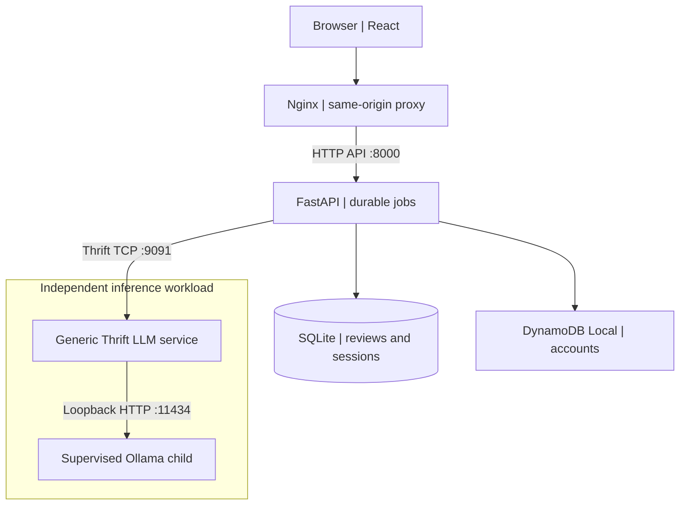

# LocalQwenDemo

A local code-review application with a React UI, a FastAPI backend, and an Apache
Thrift LLM service that supervises Ollama. Paste a code snippet, receive a structured
review, and revisit it in your account's history. Submitted code stays text: the
application never executes it or sends it to a cloud inference API.

The default deployment runs in Minikube, with an independent Ollama release serving
`qwen3:1.7b` Q4_K_M at a pinned digest. Use Argo CD to follow reviewed releases, or
install them with standard Helm commands. The GPU image targets ARM64 krunkit;
local development and a Docker-driver image-build workflow are also available.

[Quick start](#quick-start) · [Architecture](#architecture) · [Documentation](docs/README.md) · [Development](#development-and-contributing)

[Learn Apache Thrift](docs/guides/apache-thrift.md) by tracing the IDL, generated
client and processor, worker handler, and cancellation flow in this application.

## Key capabilities

- **Durable submissions:** SQLite stores jobs and checks queue capacity in one
  transaction. Matching request IDs are deduplicated per account. Queued jobs survive
  restarts, and interrupted jobs have a limited number of retries.
- **One review at a time:** a background coordinator calls a separate Thrift worker,
  which permits one model operation at a time. After a timeout, the backend waits
  for confirmed worker completion. Uncertain execution closes admission for recovery.
- **Private accounts and history:** password hashing, signed sessions, Origin and
  CSRF checks protect access. Each account can access only its own history.
- **Model identity checks:** startup checks the selected Ollama model's digest,
  capabilities and context size. Completed reviews record the model digest.
- **Reviewed releases:** CI builds changed images and opens a deployment PR with
  pinned image digests. Upgrades reuse existing Secrets and persistent volumes.

Generated findings still need human review. Output checks cannot establish that a
review is correct. This is a local, single-node application; high availability and
public internet access have not been validated.

The repository has two Python application projects: `backend/` and `inference-service/`,
with shared generated Python/Java bindings in `contracts/`. The
[Java client library](clients/java/README.md) packages the existing Java bindings
and a small SDK for other Maven applications. See the
[migration and rollback plan](docs/operations/inference-migration.md) before changing
an existing deployment.

## Quick start

### Deploy a reviewed release

1. Prepare a running Minikube cluster and its `standard` StorageClass. For the
   krunkit GPU setup, follow the [local platform guide](infra/local-platform/README.md).
   The starter VM uses 4 CPUs and 8 GiB of memory; check the
   [resource requirements](docs/reference/costs-and-limitations.md) before adding services.
2. Choose one deployment manager: [Argo CD](docs/guides/gitops.md) or
   [standard Helm](docs/guides/helm-release.md). Both use reviewed snapshots from
   `deployment-release`. The guides cover namespaces, Secrets and environment values.
3. Deploy the [independent Ollama release](deploy/helm/local-ollama/README.md) and
   the application. FastAPI calls `review-ollama.local-inference.svc.cluster.local:9091`
   over Thrift. One independent inference image owns both RPC and its loopback Ollama child.
4. Start endpoint forwarding with the command below, open the printed frontend URL
   (normally `http://localhost:8080`), and complete a real review. A Ready Pod alone
   does not confirm that inference works. Ollama GPU inference has a separate Helm
   test or Argo CD PostSync check. For a custom application namespace, use the
   foreground forwarding command in your deployment guide.

From the main source checkout, start background forwards for this repository's
application, Ollama, Argo CD and monitoring services:

```bash
python3 scripts/minikube_endpoints.py
```

The command prints each service's local address and forwarding state, then returns
while the forwards keep running. It selects only the eight configured services in
this repository. See the [endpoint guide](scripts/README.md#background-minikube-endpoints)
for the service list, status and stop commands, port settings and logs.

The local values file disables NetworkPolicy isolation. If you need isolation, follow
the Helm guide to enable policies with a CNI that enforces them. Optional monitoring
is covered in the [platform setup](infra/local-platform/README.md#monitoring) and
[observability runbook](docs/operations/observability.md).

### Build source images on Docker-driver Minikube

The optional CLI builds and loads application images, then calls Helm. It requires an
existing Docker-driver cluster and a reachable Ollama service. Prepare the tools and
Ollama connection using the [local Helm guide](docs/guides/minikube-demo.md), then run:

```bash
scripts/minikube_demo.sh init --profile minikube
```

```bash
scripts/minikube_demo.sh up --profile minikube
```

```bash
python3 scripts/minikube_endpoints.py
```

Open the forwarded UI and complete a real review. The CLI's automated `verify`
command is currently blocked by a legacy native-model inventory helper; see the
[Minikube guide](docs/guides/minikube-demo.md#status-access-and-acceptance) for the
limitation, forwarding options, rollback and cleanup. Readiness alone does not
establish inference or persistence acceptance.

## Architecture

Start with the [system diagram](docs/reference/architecture.md#system-layout),
[backend and data design](docs/reference/architecture.md#types-and-dependency-boundaries),
and [workflow diagrams](docs/reference/workflows.md) for a visual project walkthrough.

The browser reaches Nginx through a loopback port-forward. Nginx serves the React UI
and proxies `/api/` and `/health/` to FastAPI on the same origin.



The single backend process stores submissions in SQLite and returns a job ID. Its
background coordinator claims one job at a time, calls the Thrift inference worker,
and saves the result. That worker handles Ollama's native HTTP API.
The browser polls for progress and completed reviews. DynamoDB Local stores accounts.

The application Chart deploys frontend, backend and DynamoDB Local, with two PVCs
for review history and accounts. The existing Ollama Chart owns the combined
inference workload and its retained model PVC. Model weights are not baked into application images. See the
[architecture reference](docs/reference/architecture.md) for the request flow,
queue lifecycle and storage details.

GitHub Actions publishes application and Ollama images and proposes a snapshot on
`deployment-release`. Argo CD or Helm deploys the approved Charts and image digests.
Use one manager for each deployment; see the
[release guide](docs/guides/helm-release.md) for the full lifecycle.

## Documentation

The [documentation index](docs/README.md) links to setup guides, operating procedures
and references. Common starting points are:

- [API](docs/reference/api.md), [model configuration](docs/reference/model.md) and
  [security](docs/reference/security.md).
- [Troubleshooting and cleanup](docs/operations/recovery-and-cleanup.md).
- [Testing](docs/testing/README.md) and [model evaluation](docs/testing/model-evaluation.md).
- [Java SDK](clients/java/README.md), including local Maven installation and a
  standalone consumer example.
- [Dated reports](docs/reports/README.md), which preserve earlier results and their
  limits rather than describe the current deployment.

Project documentation and fixed UI text use English. User input and model output
retain their original language.

## Development and contributing

Follow [local development](docs/guides/local-development.md) to install both Python
development environments and Node 24. The full check also needs Thrift 0.25.0,
JDK 11+, Maven 3.9+, Git, Helm and kubectl; see the
[complete-check prerequisites](docs/testing/README.md#local-complete-check).
Install frontend dependencies and run the checks:

```bash
npm --prefix frontend ci
```

```bash
bash scripts/check.sh
```

These checks use model and cluster test doubles, temporary loopback services, and
offline Helm rendering. Browser tests, schema checks and real-environment acceptance
have separate entry points in the [testing guide](docs/testing/README.md).

For each change, run the relevant checks and update the guide or reference that
describes the behavior. Keep credentials, user data, weights and generated artifacts
out of commits. Record which checks ran and which were skipped or failed.
