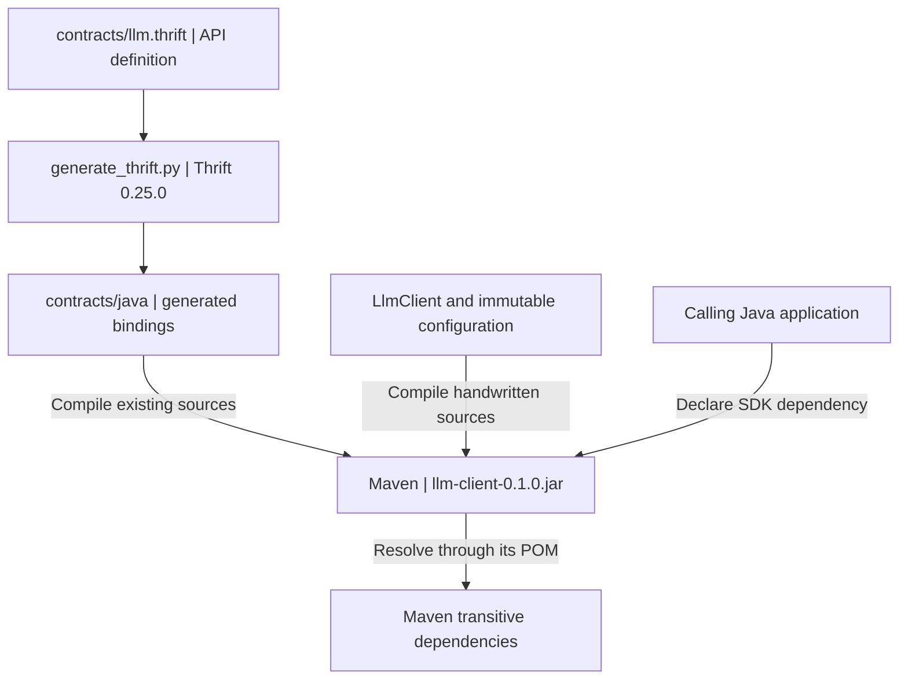

# Java LLM client 0.1.0

This is a plain Maven library JAR with coordinates `demo.llm:llm-client:0.1.0`.
It packages the existing Thrift bindings with a small synchronous client for use in
other Java applications.

## Bindings, SDK and application responsibilities

| Layer | Location | Responsibility |
| --- | --- | --- |
| Contract and generated bindings | [`contracts/llm.thrift`](../../contracts/llm.thrift), `contracts/java/demo/llm/generated/` | The IDL defines the API. Generated classes provide request/response types, exceptions, serialization, clients and processors. Regenerate them with the existing script; never edit them by hand. |
| Handwritten SDK | [`LlmClient`](src/main/java/demo/llm/client/LlmClient.java), [`LlmClientConfig`](src/main/java/demo/llm/client/LlmClientConfig.java) | Store immutable connection settings, open a connection, make one RPC and release its resources. |
| Calling application | [`Generate.java`](../../contracts/examples/java/Generate.java), [standalone consumer](examples/consumer/) | Choose messages, request IDs, generation deadlines, polling intervals, cancellation policy and output handling. |



Maven adds the existing `../../contracts/java` directory to the main source roots.
There is no second copy of the generated sources. `Generate.java` is compiled as a
test source so the external example stays checked; examples and tests are excluded
from the library JAR. Application prompts, output validation and Ollama process
management stay outside the SDK.

## Requirements and dependencies

- **JDK 11 or newer.** The POM sets `maven.compiler.release=11`. Java 11 is the LTS
  baseline for the SDK and examples, including APIs such as `String.isBlank`.
  The choice does not imply that libthrift itself requires Java 11.
- **Maven 3.9 or newer.** Enforcer checks the Java and Maven minimum versions.
- **Apache Thrift 0.25.0.** The IDL compiler, Java `org.apache.thrift:libthrift`
  dependency and Python runtime use the same version. Normal Maven builds use the
  checked-in bindings and do not need the Thrift compiler.

Dependency and build-plugin versions are pinned. A fixed JAR output timestamp
supports repeatable builds with the same sources, dependencies and toolchain;
identical class files across different JDK compiler versions are not guaranteed.

The POM retains libthrift's published transitive dependencies. It also declares
`slf4j-api:1.7.36` at compile scope: the generated `LlmService` uses it during
compilation, while libthrift's POM declares it only at runtime scope. The calling
application chooses its logging implementation. JUnit and `slf4j-nop` have test
scope and are not passed on to consumers.

This is a plain library JAR. Third-party libraries remain separate Maven
dependencies, and the SDK has no executable `main` entry point.

## Generate, test and package

Run the commands below from the repository root. Regenerating bindings requires
Apache Thrift 0.25.0:

```bash
python3 scripts/generate_thrift.py
```

Check both Python and Java bindings against the IDL byte for byte:

```bash
python3 scripts/generate_thrift.py --check
```

Compile the SDK and external example, run the JUnit TCP tests and package the JAR:

```bash
mvn -f clients/java/pom.xml clean package
```

The artifact is `clients/java/target/llm-client-0.1.0.jar`. JUnit checks the five
RPCs, structured errors, connection refusal, read timeouts, lost responses without
resubmission, frame limits, strict message headers and concurrent calls. Test peers
observe EOF to verify connection cleanup on successful and failed calls.

With the existing backend and inference-service development environments installed,
run the combined inference check:

```bash
bash scripts/checks/inference.sh
```

This checks bindings, packages/tests the Maven SDK and runs Python service tests.
The Java fixture builds the SDK once, then exercises real TCP calls to Python's
generated processor and controlled handlers. Coverage includes errors, cancellation,
i64 values, lost-response recovery, eight concurrent calls and connection cleanup.
The shared-ID test uses the real `InferenceHandler` with a model double to confirm
that Java and Python observe one execution.

The gate also installs the SDK into the selected local Maven repository, copies
the standalone consumer outside the checkout, and builds and runs it through
Maven. It does not publish remotely. These tests verify real RPC interoperability;
model computation uses doubles and requires neither Ollama nor a GPU.

The original script delegates to the same Maven build, then runs the external
example against the packaged JAR. To build without calling a service:

```bash
python3 scripts/java_thrift.py --compile-only
```

To submit the example prompt to an already running service:

```bash
python3 scripts/java_thrift.py --host 127.0.0.1 --port 9091
```

Set `MAVEN` to the absolute path of a Maven executable if `mvn` is not on PATH.
Maven also honors `MAVEN_ARGS` and `MAVEN_OPTS`. To use a workspace-local repository
for the gate, supply an absolute path so the copied consumer resolves the same SDK:

```bash
MAVEN_ARGS="-Dmaven.repo.local=$PWD/.local/m2-repository" bash scripts/checks/inference.sh
```

## Install locally and use the SDK elsewhere

| Maven phase | Result |
| --- | --- |
| `package` | Compile, test and create the JAR in `target/`. It is not yet installed for other projects to resolve locally. |
| `install` | Complete the earlier phases, then install the JAR and POM into the local repository, normally `~/.m2/repository`. |
| `deploy` | Complete the earlier phases and upload artifacts to a configured remote repository. This module has no remote publication configuration. |

```bash
mvn -f clients/java/pom.xml install
```

The default installation directory is `~/.m2/repository/demo/llm/llm-client/0.1.0/`.
Another Maven project needs only this SDK dependency; Maven resolves Thrift and the
other required libraries from its POM:

```xml
<dependency>
  <groupId>demo.llm</groupId>
  <artifactId>llm-client</artifactId>
  <version>0.1.0</version>
</dependency>
```

The [consumer POM](examples/consumer/pom.xml) is a complete independent example. It
has no parent POM, repository source references, `systemPath` or other library
dependencies, and compiles with release 11. After installing the SDK, copy the
consumer to a new directory; choose a different path if this one already exists:

```bash
cp -R clients/java/examples/consumer /tmp/llm-consumer
```

```bash
mvn -f /tmp/llm-consumer/pom.xml clean package
```

Run it against an existing service. The optional `cancel` argument submits a second
task and attempts to cancel it:

```bash
mvn -f /tmp/llm-consumer/pom.xml exec:java -Dexec.args="127.0.0.1 9091 cancel"
```

Both projects must use the same local repository. The first Maven run needs network
access for dependencies and plugins; use `-o` once all required artifacts are
cached. The consumer deliberately leaves logging unbound, so an SLF4J binding
notice is expected until the application selects an implementation.

## Public API and complete example

The API uses generated request, response and exception types directly. These calls
show the method signatures in use; `request` is an application-created
`GenerationRequest`:

```java
LlmClient client = new LlmClient(new LlmClientConfig(
        "127.0.0.1", 9091, 1000, 2000, 2 * 1024 * 1024));
ModelInfo info = client.getModelInfo();
Health health = client.getHealth();
GenerationSnapshot admitted = client.startGeneration(request);
GenerationSnapshot current = client.getGeneration(info.instance_id, request.request_id);
GenerationSnapshot cancelling = client.cancelGeneration(info.instance_id, request.request_id);
```

For a complete compilable example, see
[`Consumer.java`](examples/consumer/src/main/java/demo/consumer/Consumer.java).
It connects, checks model information and health, creates a request, submits it
once, polls for a terminal result and optionally cancels a second task. It also
shows how to query the original IDs after a lost submission response. The example
uses a generation deadline of at most three seconds and a separate ten-second
polling budget; adjust these application choices for a real workload.

`LlmClientConfig` has five immutable instance settings: host, port, connection
timeout, read timeout and maximum frame bytes. Timeouts are positive milliseconds;
frame size is positive bytes excluding the four-byte frame header. Ports must be
1–65535. `defaults(host, port)` uses two seconds for each timeout and a 2 MiB frame
limit. Increasing the client limit does not raise the server's own 2 MiB limit.

Construction does not connect. Each method blocks for one RPC and closes its
connection before returning, so the SDK has no persistent resource to `close()`.
One `LlmClient` may be shared by threads because every call creates a separate
generated client, protocol, transport and `TConfiguration`. Generated DTOs remain
mutable: callers must not change a request while another thread is sending it,
and must manage any later sharing of response objects.

## Timeouts, errors and uncertain execution

| Setting or budget | Meaning |
| --- | --- |
| `connectTimeoutMillis` | Maximum TCP connection wait; it does not necessarily bound JVM DNS resolution. |
| `readTimeoutMillis` | Maximum wait for an individual blocking socket read. It is not a total RPC deadline and does not configure a write deadline. |
| `GenerationRequest.deadline_ms` | Server-side generation budget measured from admission, including queueing. Closing the connection does not cancel the task. |
| Application polling budget | How long the caller chooses to wait. Expiry does not stop generation; retain the IDs for later queries or cancellation. |

The SDK propagates the original exceptions. Public methods declare Thrift's
`TException`; methods with a declared remote error also list `LlmError`. Handle the
specific types before the common parent:

```java
try {
    client.getGeneration(instanceId, requestId);
} catch (LlmError remote) {
    // Inspect remote.code, remote.message and remote.retryable.
} catch (org.apache.thrift.transport.TTransportException transport) {
    // Inspect getType() and getCause(); keep the original request and instance IDs.
} catch (org.apache.thrift.TException protocolOrApplication) {
    // Investigate protocol or application compatibility without discarding the cause.
}
```

With libthrift 0.25.0, connection refusal normally produces `NOT_OPEN` with a
`ConnectException` cause. A connection timeout also produces `NOT_OPEN`, with a
`SocketTimeoutException` cause. A socket read timeout produces `TIMED_OUT` with
that timeout cause. An oversized incoming frame produces `CORRUPTED_DATA`; the
SDK rejects an oversized outgoing frame with `MESSAGE_SIZE_LIMIT` before sending
the buffered request. Inspect types and causes rather than parsing error messages.
Try-with-resources closes connections after open, serialization, protocol, transport
and remote failures as well as normal returns.

An RPC throwing `LlmError` differs from a successful RPC returning a `FAILED`
snapshot: inspect the snapshot's `error` for the latter. `retryable=true` informs
the application's policy; the SDK does not retry automatically.

A failed `startGeneration` response may follow an accepted or completed task.
Save the original `request_id`, `instance_id` and payload before submitting, then
use `getGeneration` with those IDs to reconcile. Do not automatically resubmit or
allocate a new ID to hide an uncertain outcome. `not_found`, an expired result or
a changed instance cannot establish that the old task never executed. Same-ID
idempotency also requires the same payload and is limited to the current instance
and retention period.

`CANCELLING` is nonterminal. Continue querying until `SUCCEEDED`, `FAILED` or
`CANCELLED`; a task may finish before cancellation takes effect. For unknown states
or error codes, retain the IDs and avoid guessing that resubmission is safe.

## Connection strategy and future reuse

The wire stack is **TCP → TFramedTransport → TBinaryProtocol**, with strict reads
and writes. Every short RPC opens and closes its own connection. A small internal
framed-transport subclass adds an outgoing frame limit; libthrift checks incoming
frames. This keeps resource ownership and concurrent calls straightforward.
The cost is a TCP handshake, socket allocation and close for each poll, with
possible TIME_WAIT accumulation.

RPC traffic depends on polling frequency and the number of callers. For example,
100 callers polling every 100 ms create about 1,000 query RPCs per second, plus
submissions, health checks and cancellations. One active model generation does
not imply low RPC traffic.

Measure connection and RPC p50/p95/p99 latency, connections/RPCs per second,
timeouts, refusals and resets before adding reuse. Also observe file descriptors,
TIME_WAIT, CPU, server connection-slot occupancy, processing time and queueing.
Account for the current server's default 32 concurrent connections, three-second
idle timeout and accept backlog, including competition between applications.
Idle pooled connections would still occupy server slots.

If connection setup becomes a meaningful bottleneck, a pool needs exclusive
borrowing, bounded capacity, a borrow-wait timeout, broken-connection eviction,
idle expiry and defined shutdown behavior. Only one thread may use a borrowed
client/transport. Handle server restarts, idle disconnects, per-instance settings
and total capacity across pools. A broken connection must not cause automatic
replay of an uncertain submission.

## SDK compatibility and future remote publication

SDK version `0.1.0` and generic Thrift API v1 describe different interfaces and do
not need matching version numbers. Generated DTOs are public SDK types, so binding
changes also require Java source/binary compatibility review as well as wire
compatibility checks. Follow the field-ID, enum, optional-field and semantic rules
in [`contracts/README.md`](../../contracts/README.md). Coordinate breaking API
changes with service and client upgrades. Update the compiler/runtime versions
together, regenerate and run Java/Python TCP tests when upgrading Thrift.

The current coordinates are local demo coordinates. Before remote publication,
choose coordinates and a repository you control; add project URL, license, SCM and
developer metadata. Add pinned source/Javadoc, signing and staging/release plugins
as required by that repository. Configure release/snapshot destinations through
`distributionManagement`, with matching server IDs in Maven `settings.xml` or CI
secrets. Keep credentials out of the POM. Define immutable release versions,
compatibility checks and publishing permissions, and document how consumers can
access the repository.

Upstream references: [libthrift 0.25.0 POM](https://repo.maven.apache.org/maven2/org/apache/thrift/libthrift/0.25.0/libthrift-0.25.0.pom),
[Thrift Java compiler settings](https://github.com/apache/thrift/blob/v0.25.0/lib/java/gradle/sourceConfiguration.gradle),
[Maven lifecycle](https://maven.apache.org/guides/introduction/introduction-to-the-lifecycle.html).
