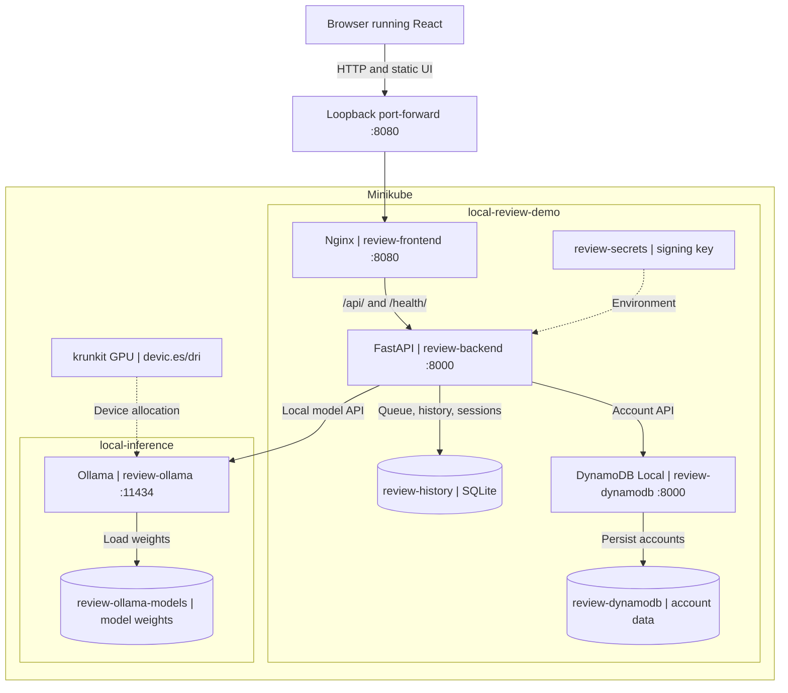
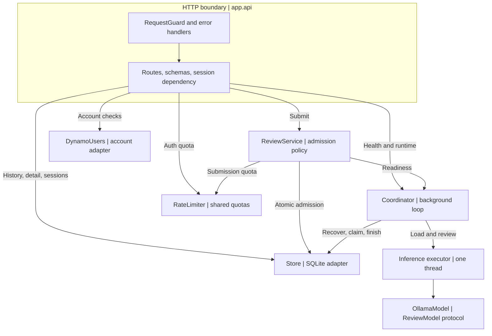
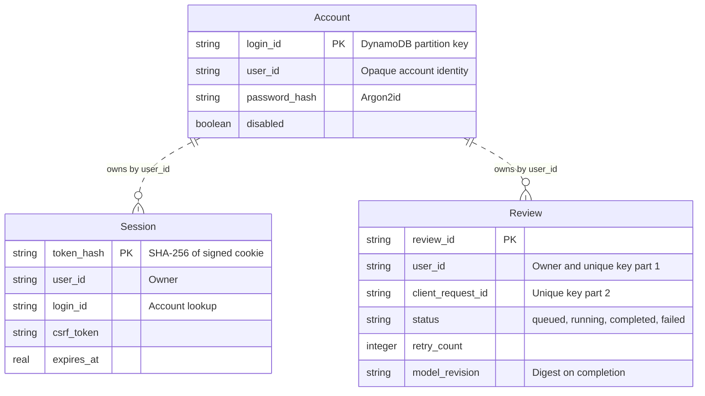

# Architecture

[Documentation index](../README.md)

LocalQwenDemo accepts code as text, saves a review job, and generates a three-section
review through a local Ollama service. The diagrams below describe the maintained
Minikube deployment and the boundaries inside its backend.

| View | What it explains |
| --- | --- |
| [System layout](#system-layout) | Services, namespaces, persistent volumes and local access |
| [Backend design](#types-and-dependency-boundaries) | HTTP, admission, coordination and adapter responsibilities |
| [Data relationships](#storage) | Accounts, sessions and durable review records |
| [Workflow diagrams](workflows.md) | Authentication, review execution, admission, generation, recovery and releases |
| [Observability diagram](observability.md#collection-and-ownership) | Metrics, logs, dashboards and platform ownership |

## System layout

React runs in the browser. Nginx serves the bundle and proxies API and health
requests. Namespace groups show placement; storage cylinders are PVC-backed data.
Solid arrows show calls or storage access; dotted arrows show
configuration or device dependencies. Responses return along the same call path.



The default release names are `local-review` and `review-ollama`. The backend
contains one Uvicorn process, one coordinator and one inference executor
thread. The application Chart does not install Ollama. The independent Ollama Chart
targets ARM64 krunkit and requests the GPU device advertised by the platform's device
plugin. [Local development](../guides/local-development.md) uses Vite's proxy and
explicit local service endpoints instead of this Nginx/namespace layout.

Namespace boxes express deployment ownership, not network isolation. The maintained
Minikube values disable NetworkPolicy. The signing Secret is prepared separately and
reused on upgrades. See [deployment and persistence](#deployment-and-persistence) for
the two deployment managers and storage retention.

## Request flow

The [architecture overview](../../README.md#architecture) describes the application in
Minikube and its deployment tools. React executes in the browser; Nginx serves its static
bundle and provides the same-origin API proxy. The background coordinator and one-thread
inference executor run within the FastAPI process.

### One review, end to end

See the [review sequence](workflows.md#review-from-submission-to-history) and
[admission decisions](workflows.md#admission-and-idempotency) for visual walkthroughs.

1. `RequestGuard` bounds the JSON body and assigns a request ID. FastAPI validates
   `ReviewInput`; the session dependency verifies the signed cookie, account, Origin
   and CSRF token. The user ID comes only from this authenticated session.
2. The review route obtains a typed `ReviewService` dependency. Its `submit` method
   checks for blank or oversized input, coordinator readiness, and the per-user
   submission rate limit, in that order. These checks also apply to idempotent retries.
   Exact token counts are checked later in the worker, using Ollama's response.
3. `Store.create_review` uses **one `BEGIN IMMEDIATE` transaction** for the existing-key
   lookup, payload conflict check, total/queued capacity checks, active-user check and
   insert. Same-key/same-input retries return the existing row before capacity checks.
   A duplicate with different input returns 409. Commit completes before the service
   emits its acceptance log.
4. `CreateReviewResult` carries the row separately from `created` and the transaction's
   queue-depth snapshot. Only newly inserted reviews emit `review_submitted`.
   `ReviewAccepted` exposes three fields and the route returns 202 without waiting
   for inference. A storage failure never produces a successful acceptance response.
5. The coordinator claims a queued review, persists its running state and sends it to
   its sole inference executor. `OllamaModel` calls the configured local Ollama service
   once for each section: Summary, Findings and Suggestions. All three calls share
   one stop event and deadline; generation metrics record each call.
6. The coordinator persists completion or a safe failure through `Store.finish`.
   The browser polls an owner-scoped detail query. `ReviewDetail` and `HistoryPage`
   allowlist public fields; list entries omit source/result bodies. Timestamps remain
   numeric Unix seconds, IDs remain strings, and nullable fields remain JSON null.

### Types and dependency boundaries

This is a code-level view of one backend process, assembled by `create_app`. Arrows
show selected calls and dependencies. The coordinator owns background work; HTTP
submission only commits a job.



`api/schemas.py` uses Pydantic only at the HTTP boundary: input validation, response
allowlists and the optional OpenAPI schema. `domain.py` uses TypedDict for session,
account, review and history records: they remain ordinary dictionaries and are not
reparsed into domain models at every layer. SQLite/DynamoDB adapters annotate their
known row shapes; these annotations are not runtime database validation.
`CreateReviewResult` and generation metrics are small dataclasses because
operation metadata and mutable execution observations are not HTTP payloads.

`create_app` assembles settings, stores, the limiter, model, coordinator and service for
each application instance. `api/dependencies.py` is the only route-facing adapter from
Request/app state to those typed dependencies. The service receives its Python
dependencies explicitly and does not depend on HTTP Request or Response objects. Routes
call `Store` directly for simple history and detail queries scoped to the authenticated
user. Callers use `app.inference`, `app.persistence` and `app.api`.
`app.inference.model` contains the injected model protocol; `app.inference.ollama` is
the only real adapter.

### Shared readiness and rate limits

Both `/health/ready` and `/api/v1/runtime` call the HTTP-independent
`health.check_readiness`. Its immutable result carries the observed status and safe
error code. The health route maps failures to HTTP 503; runtime keeps HTTP 200 for
successful observations of an unavailable service and retains the same diagnostic
error code in request diagnostics. Runtime presents shutdown as `shutting_down`.

The observation calls SQLite `ping` only while the coordinator is ready; this
is a writable-store check that also removes expired sessions. Loading, draining and
closing skip that check. The last operational status in a shutdown health
response is preserved even though its HTTP status is 503.

Authentication and review admission share one `rate_limit.RateLimiter` per app.
A lock keeps quota checking and recording atomic across worker threads. Attempts
rejected by the limiter do not consume quota; attempts that pass it do, even if a
later check rejects them. See [security](security.md#authentication) for the limits.

## Boundaries

The browser edits and displays text. The frontend serves the UI and proxies `/api/*`
and `/health/*` to `review-backend:8000`, preserving normal Cookie, Origin and CSRF
handling. The browser polls persisted review status and renders only sanitized
completed Markdown.
The cluster is accessed through an explicitly owned loopback forward, not a public ingress.

One Uvicorn process and one background coordinator share a dedicated inference executor
with one thread. Each review invokes that executor once to generate Summary, Findings
and Suggestions in order. Generated text from one section is never used as an
instruction for another. The [model reference](model.md#configuration-and-generation)
defines the shared token budget, sampling policy, output validation and the limited
removal of unfinished text when a section reaches its token limit.

Ollama renders the selected model's native template and tokenizes each prompt. Requests
set `think=false`, `truncate=false` and `shift=false`; the backend rejects unexpected
thinking/tool output and checks actual prompt token counts before saving a result.
See [model configuration](model.md) for startup checks and model switching.

DynamoDB and SQLite operations run in FastAPI's thread pool or `asyncio.to_thread`; model execution never runs on the main event loop. One backend replica and the `Recreate` rollout strategy preserve this ownership. There is no HPA, distributed queue, conversational store, external LLM, or code execution path.

## Storage

The relationships below are **logical ownership**, enforced by application queries.
Accounts live in DynamoDB Local; sessions and reviews share SQLite. There are no SQL
foreign keys between these records and no transaction across the two stores. The
diagram lists identity and ownership fields; the text below describes the remaining
record fields.



| PVC                  | Mounted by                       | Data / configured size                                                |
| -------------------- | -------------------------------- | --------------------------------------------------------------------- |
| `review-history`     | Backend at `/data`               | `reviews.sqlite3`: queue, review bodies, history and sessions; 10 GiB |
| `review-dynamodb`    | DynamoDB Local at `/data`        | Account records and password hashes; 1 GiB                            |
| `review-ollama-models` | Independent Ollama at `/models` | Model weights; 4 GiB |

These are the default claim names and sizes. Existing-claim values can select retained
PVCs; changing the Ollama release name also changes its default claim name.

The signing key is a separate `review-secrets` Kubernetes Secret. Host-side deployment
state is also separate: it records target/build/acceptance evidence and private credentials,
not application history. Default undeploy retains both application PVCs and signing material.
Hostpath capacity declarations are not disk reservations or backups.

Older releases created a `review-model-cache` PVC for in-process Hugging Face models.
The application no longer creates or mounts it. Its existing Helm keep and Argo CD
`Prune=false,Delete=false` annotations retain it during upgrades; this change does not
delete its data. Argo CD installations need the
[cache retirement annotation](../guides/gitops.md#retire-the-legacy-backend-cache)
before syncing the removal to keep the application Synced.
Old `persistence.modelCache` values remain accepted but are ignored.
Ollama's separate model PVC remains in use.

`backend/app/persistence/storage.py` provides parameterized SQLite queries, explicit transactions, and schema versioning through `PRAGMA user_version`. Version 1 is created atomically; unknown versions fail startup. Future schema changes must introduce explicit ordered migrations before increasing the supported version. SQLite uses WAL, `synchronous=FULL`, and a five-second busy timeout. Each operation creates and closes its own connection.

Reviews store review/user/client IDs, language, source, result, state, error code/message, model ID/revision, retry count, and creation/update timestamps. Indexes cover user/reverse time ordering, status/creation ordering, and a unique `(user_id, client_request_id)` key. Transactions serialize duplicate submissions and capacity checks. A duplicate key with identical input returns the existing job, even after completion; a changed payload returns 409.

History listings are cursor-paginated and omit source/result text. Detail access and pagination cursors always derive user identity from the authenticated session. Another user's ID returns 404. User input never supplies authoritative `user_id` values.

Sessions are signed opaque random tokens; only a SHA-256 token hash, user identity, CSRF token, and expiry are stored in SQLite. Logout deletes the session, so replaying a copied cookie fails. DynamoDB stores account identifiers, Argon2id hashes, creation timestamps, disabled flags, and opaque user IDs. It does not store review history.

## Queue and restart policy

The [job lifecycle](workflows.md#durable-job-lifecycle) and
[coordinator lifecycle](workflows.md#service-startup-timeout-and-recovery) diagrams
show persisted states separately from process health.

By default, the queue allows eight queued jobs plus one running job, with at most one active job per account. Admission and status transitions are persisted before HTTP acceptance or inference. History writes fail closed: no success is returned when storage fails.

Before recovering the queue, startup checks the account store. It retries only
explicitly allowed transport failures, with a 120-second retry budget. Each SDK call
makes one attempt, and retries run serially with waits of at most 10 seconds. An
in-flight call is allowed to finish, so this is not a hard process deadline.
Readiness stays false throughout. See [startup retry
boundaries](../operations/recovery-and-cleanup.md#temporary-account-store-connection-failures).
This does not retry other initialization stages or inference.

On process restart, queued jobs are recovered. Stale running jobs are requeued once, incrementing `retry_count`. A second interruption fails them as `interrupted`. A reduced queue capacity preserves the oldest jobs and fails excess recovered work. Ordinary inference failures, empty or invalid output, and timeouts are not automatically retried; the user may make a new submission.

A timed-out inference is marked failed, receives a cooperative stopping signal, and makes readiness false until its thread exits. The three section generations do not receive separate timeout windows: the 300-second minikube inference deadline covers the complete review, and stop or deadline expiry prevents another section from starting. No second inference starts during draining.

If the inference thread exits within the 30-second draining window, readiness recovers, liveness remains healthy, and the Pod is not restarted. Only draining that exceeds 30 seconds enters `inference_stuck`, makes liveness false, stops the coordinator, and causes Kubernetes to restart the process. Python cannot forcibly kill a native thread. The 60-second Pod termination grace period bounds shutdown even if native execution becomes stuck. A killed running job is recovered under the documented retry policy.

### Coordinator states and shutdown

`CoordinatorState` determines readiness and liveness. State changes go through
`_transition`; `ready` and `live` are read-only properties.
`closing` is an independent lifecycle flag: shutdown can occur during loading,
normal processing or draining without hiding the last operational state.

| State | Ready (while not closing) | Live | Next behavior |
| --- | --- | --- | --- |
| `model_loading` | false | true | Initialize storage/accounts, recover the queue, and verify the selected model through Ollama |
| `ready` | true | true | Claim and execute jobs serially |
| `inference_draining` | false | true | Wait for the timed-out executor future; never start another job |
| `inference_stuck` | false | false | Stop claiming jobs; late thread exit cannot restore readiness |
| `startup_or_storage_failure` | false | false | Stop the worker loop; restart/recovery is required |

If inference exits during the drain window, the coordinator returns to `ready`, whether
inference stopped cooperatively, succeeded late or failed. The stored job remains failed
with a timeout; a late result does not replace it. Shutdown sets `closing`, clears
readiness through the property, signals the stop event and waits for a bounded grace
period before cancelling the coordinator task. Loading or draining finishing during
shutdown cannot reopen admission. Python cannot forcibly stop a stuck worker thread;
process termination is the final local bound. The Ollama adapter normally cancels its
HTTP operation and closes the connection, while Ollama handles remote generation cleanup.

## Design tradeoffs and scaling boundary

The implementation deliberately has one Uvicorn process, one coordinator and one
inference executor thread. This limits the application to one active review at a time;
HTTP handlers and database operations can still execute in worker threads. It is
appropriate for a local demonstration, not a multi-worker deployment guarantee.
`MODEL_INFERENCE_CONCURRENCY=1` is validated, and deployment starts Uvicorn with one
worker and one replica. Increasing Uvicorn workers would create more Ollama clients,
coordinators and limiters, allowing concurrent inference requests and conflicting
queue recovery across processes.

SQLite keeps queue admission, idempotency, history and session revocation together with
short transactions and no separate broker. WAL supports concurrent readers, while writes
serialize. Its queue survives process restarts, but it provides no worker lease or
distributed execution ownership. DynamoDB Local holds accounts and Argon2id hashes
separately, exercising the DynamoDB API without cloud credentials. This adds a second
local dependency. There is no transaction spanning account creation and SQLite session
creation. If registration succeeds but saving the session fails, the account remains and
the user must log in later.

Multi-process operation would require explicit worker ownership and leases. Recovery
would need to avoid requeueing another live worker's job. Workers would also need shared
admission and rate-limit policies, planned model memory usage, and consistent
cancellation and health behavior. Database placement, write contention and durable
handoff would also need review. The existing SQLite transaction prevents duplicate
admission; it does **not** make inference exactly-once or make current startup recovery
safe across workers. None of those distributed capabilities is implemented here.

## Deployment and persistence

The [release workflow](workflows.md#release-deployment-and-rollback) shows source
validation, image publishing, snapshot approval, deployment and rollback.

The application and independent Ollama service have separate Helm Charts under
`deploy/helm`. Approved release snapshots pin their images. Deploy with standard Helm
commands or let Argo CD reconcile the release branch, using one manager per deployment.
The application references a stable external signing Secret and uses two PVCs for
history/queue/sessions and DynamoDB Local accounts. Ollama
has its own model PVC. See the [Helm guide](../guides/helm-release.md) and
[GitOps guide](../guides/gitops.md) for ownership and storage retention.

The optional local Helm CLI verifies the selected Docker-driver profile and uses a
private kubeconfig and operation lock. Local build and acceptance evidence is keyed
by cluster, namespace and release; it does not replace Helm release state.
Readiness and acceptance have independent reports.

## Observability flow

The backend emits allowlisted JSON events to stderr and serves an internal `/metrics`
endpoint from its per-application Prometheus registry. The Helm CLI `logs` command
reads the selected backend container's logs. Optional Terraform monitoring runs
Prometheus, Grafana and Alertmanager; the application Chart supplies its monitor,
rules and dashboards. The [collection diagram and observability contract](observability.md) and
[local runbook](../operations/observability.md) define safe correlation, timing
boundaries and unknown measurements. Scraping never submits inference or runs the
writable readiness probe.

## Frontend task status

The result panel shows submission, queueing, execution, and final task states separately
from service readiness. It does not display a time estimate or progress percentage.
During real inference, it explains that Ollama response time depends on code length and
machine load. Simulated results are labeled explicitly. These messages do not change
the 300-second deployment timeout or the retry behavior for an unconfirmed submission.

## Implementation map

The package layout follows existing responsibilities with one level of grouping:

```text
backend/app/
  main.py, config.py, model_config.py, domain.py, errors.py
  review_service.py, coordinator.py, health.py, rate_limit.py, logging.py, startup.py
  monitoring.py
  api/
    routes/                   # auth, reviews, health, runtime and internal metrics
    auth.py, dependencies.py, schemas.py, middleware.py, http_errors.py
  inference/
    model.py, ollama.py, prompts.py, generation.py, review_output.py, identity.py
  persistence/
    storage.py, users.py, local_dynamodb.py, users_startup.py, initialize_users.py
```

The root owns application assembly, business coordination and shared diagnostics.
`api` owns HTTP transport; `inference` owns model execution and pure generation rules;
`persistence` owns local storage and account-store startup checks. `startup.py` stays
at the root because it is shared safe diagnostics, not the account retry mechanism.

The frontend separates session restoration, workspace actions and panel rendering:

| Source | Responsibility |
| --- | --- |
| [App.tsx](../../frontend/src/App.tsx) | Restore the session and choose the sign-in or workspace view. |
| [Auth.tsx](../../frontend/src/Auth.tsx) | Sign-in and registration forms, validation and submission state. |
| [Workspace.tsx](../../frontend/src/Workspace.tsx) | Own review state, restore active jobs, poll results and retain input for explicit delivery retries. |
| [HistorySidebar.tsx](../../frontend/src/HistorySidebar.tsx) | Render history, pagination and account actions. |
| [SourcePanel.tsx](../../frontend/src/SourcePanel.tsx), [CodeEditor.tsx](../../frontend/src/CodeEditor.tsx) | Render source input, language selection and submission controls. |
| [ReviewResult.tsx](../../frontend/src/ReviewResult.tsx) | Render review content, model provenance and task status messages. |
| [runtime.ts](../../frontend/src/runtime.ts), [RuntimePanel.tsx](../../frontend/src/RuntimePanel.tsx) | Poll and present instance readiness independently of review progress. |

`Workspace` owns the state and asynchronous actions shared by its panels. The panels
receive values and callbacks so their rendering can be read without tracing network
requests. The `locked` ref prevents duplicate actions before React renders; `blocked`
controls the visible disabled states. An unconfirmed delivery retains the serialized
request and its idempotency key until the user explicitly retries it.

Use these sources when auditing or changing the design:

| Concern                                              | Source                                                                                           |
| ---------------------------------------------------- | ------------------------------------------------------------------------------------------------ |
| Application construction and HTTP contracts | [main.py](../../backend/app/main.py), [schemas.py](../../backend/app/api/schemas.py), [routes](../../backend/app/api/routes) |
| Admission policy and typed dependencies | [review_service.py](../../backend/app/review_service.py), [dependencies.py](../../backend/app/api/dependencies.py), [domain.py](../../backend/app/domain.py) |
| HTTP protection and error mapping | [middleware.py](../../backend/app/api/middleware.py), [http_errors.py](../../backend/app/api/http_errors.py) |
| Durable admission, recovery and sessions             | [storage.py](../../backend/app/persistence/storage.py)                                                       |
| Single executor, readiness and cancellation/draining | [coordinator.py](../../backend/app/coordinator.py)                                               |
| Inference and model/context verification | [ollama.py](../../backend/app/inference/ollama.py) |
| Prometheus metrics and read-only collection | [monitoring.py](../../backend/app/monitoring.py), [metrics.py](../../backend/app/api/routes/metrics.py) |
| Prompt, output and generation policy | [prompts.py](../../backend/app/inference/prompts.py), [review_output.py](../../backend/app/inference/review_output.py), [generation.py](../../backend/app/inference/generation.py) |
| Local accounts transport                             | [users.py](../../backend/app/persistence/users.py), [local_dynamodb.py](../../backend/app/persistence/local_dynamodb.py) |
| Deployment composition                               | [Application Chart](../../deploy/helm/local-review/Chart.yaml)                  |

The [script guide](../../scripts/README.md#organization-and-dependency-boundaries)
maps shared-state, target, deployment and cleanup modules.
