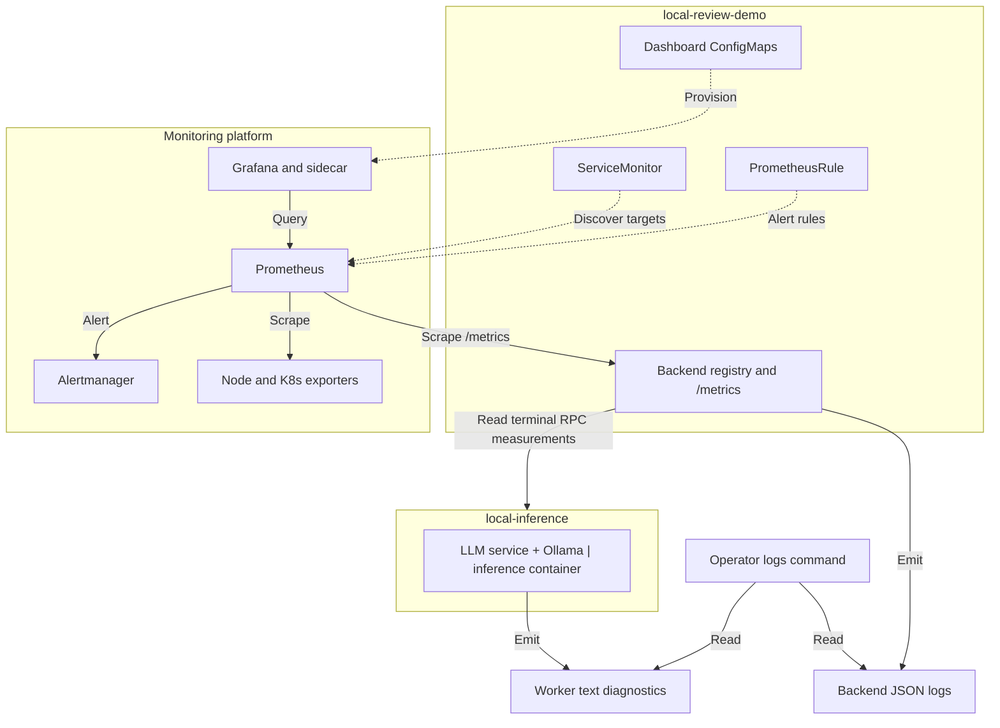

# Local observability

[Documentation index](../README.md)

The backend emits content-free JSON diagnostics and internal Prometheus metrics.
The Thrift worker has a separate text log stream and returns generic usage/timing metadata. The backend derives section measurements
from its three application-owned generations.
The optional Terraform monitoring platform provides Prometheus, Grafana and Alertmanager;
the application Chart owns its ServiceMonitor, rules and dashboards. Use the
[local runbook](../operations/observability.md) and record measured, unavailable and
inferred facts separately. Monitoring does not run synthetic reviews or repair workloads.

## Collection and ownership

Solid arrows show collection or queries; dotted arrows show configuration supplied
by the application Chart. The monitoring services belong to the optional Terraform
platform in the `monitoring` namespace; application resources live in
`local-review-demo`. The inference Chart owns the combined service in
`local-inference`. Logs are read separately from the backend and inference containers.

The [system layout](architecture.md#system-layout) shows the inference and data
services. Resource dashboards observe Ollama through Kubernetes/container metrics;
the application does not expose an Ollama metrics endpoint. Scraping `/metrics`
uses a read-only queue snapshot and never runs inference or the writable readiness
probe. The frontend does not proxy `/metrics`. Alertmanager has no external receiver
configured, and this platform has no centralized log database.

Sources: [metrics endpoint](../../backend/app/api/routes/metrics.py),
[ServiceMonitor](../../deploy/helm/local-review/templates/servicemonitor-review-backend.yaml),
[Thrift observations](../../backend/app/inference/rpc/client.py),
[monitoring platform](../../infra/local-platform/terraform/platform/monitoring.tf),
[platform values](../../infra/local-platform/terraform/platform/values/monitoring.yaml).

## Metrics contract

`GET /metrics` is an internal backend endpoint on port 8000. It needs no user session
and is omitted from OpenAPI. The frontend does not proxy it. Each `create_app` owns
its registry; there is no global shared registry. The inference worker is a separate
process with no Prometheus endpoint. Generic usage/timing measurements are imported
when the backend receives a terminal snapshot.
The endpoint remains available during model loading, drain and storage errors.
Scrapes do not increment HTTP metrics or emit normal request logs.

| Metric | Type and meaning |
| --- | --- |
| `review_http_requests_total` | Counter by fixed `method`, allowlisted route template and HTTP `status`; includes health probes |
| `review_http_request_duration_seconds` | Histogram by method/route, from request handling to response headers starting |
| `review_submissions_total` | Counter of newly committed submissions; idempotent retries are excluded |
| `review_rejections_total` | Counter by safe `reason` for service admission rejections; HTTP authentication/validation failures remain HTTP observations |
| `review_completions_total` | Counter by `outcome=completed` or safe error code, recorded after terminal-state persistence |
| `review_queue_depth`, `review_queue_capacity` | Current persisted waiting count and configured capacity |
| `review_queue_oldest_age_seconds` | Age from original submission of the oldest waiting review; zero only for a successfully observed empty queue |
| `review_metrics_collection_success` | Whether the read-only queue snapshot succeeded |
| `review_coordinator_state` | One-hot operational state: `model_loading`, `ready`, `inference_draining`, `inference_stuck`, `startup_or_storage_failure` |
| `review_worker_busy` | Whether the backend's Thrift client executor call is running, including drain; not a direct remote-worker or GPU measurement |
| `review_queue_wait_seconds` | Histogram from original submission to this execution attempt starting |
| `review_duration_seconds` | Histogram from original submission to persisted terminal state |
| `review_execution_duration_seconds` | Monotonic client executor duration, including RPC calls, polling waits and cancellation drain |
| `review_generation_duration_seconds` | Service-reported native chat duration for a successful section, including first-content time |
| `review_first_content_duration_seconds` | Native chat request to first nonempty content, measured inside the service |
| `review_input_tokens_total`, `review_generated_tokens_total` | Observed token counters by fixed section |
| `review_output_limit_total` | Counter of completed section responses reaching their output budget |

The final four rows use only `section=summary|findings|suggestions`; duration metrics
are Histograms. Standard `_bucket`, `_sum`, `_count` and `_created` samples follow
the client library's exposition format. Unknown HTTP routes become `unknown`, unknown
methods become `OTHER`, and error labels use the same safe-code allowlist as logs.
No request/review ID, account, raw URL/query, source/hash, prompt, generated text or
exception message is a metric label. Kubernetes target identity labels are supplied
by service discovery, not copied from request data.

Counters describe events observed by the current process and reset on restart.
Completion/rejection labels start at zero so a first event can contribute to a later
Prometheus `increase`. They are not an audit of persistent history: recovery can
requeue or terminate old records, and a crash can occur between commit and observation.
Queue gauges instead query the durable store. That query uses a short read-only
connection and never calls the writable readiness/session-cleanup probe. On collection
failure, depth and age are omitted and collection success is zero; stale data must not
be interpreted as an empty queue.

Queue wait and total review duration retain the original submission timestamp. After
recovery, they can include earlier attempts and downtime. Executor duration is a
separate attempt measurement. A timed-out review is persisted as failed before drain
finishes, so worker occupancy can remain one after completion is recorded. The state
gauge preserves the last operational state during shutdown; it is not a fresh readiness
probe or a writable storage-health guarantee.

The busy gauge can return to zero after a lost RPC response while remote execution
is still uncertain. The coordinator then remains `inference_stuck`; a zero local
gauge does not establish that another model operation can safely start. Section
measurements can also be missing if a terminal snapshot was never received.

The service measures native chat timings around its HTTP stream. These exclude
service queueing, Thrift transport, backend polling and the identity/device checks
outside that stream. The backend records them when it receives a successful
generation result; failed or unobserved sections have no new timing observation.

Startup validation does not increment review-generation metrics. Section latency
histograms have zero observation-count baselines; no zero-duration observations are
inserted. Dashboards display latency only when the observation rate is positive.
Unobserved token counts remain absent. An interrupted stream may contain text without
a terminal token count; do not infer zero generated tokens. These metrics
describe calls through this backend, not other clients of the shared Ollama server.

## Platform ownership and limits

Terraform owns the optional `monitoring` Helm release and Operator CRDs. The application
Chart defaults monitoring resources off; `values-monitoring.yaml` enables them after
the platform is ready. Argo CD uses that overlay in its approved application snapshot.
Prometheus selects `release: monitoring` resources in `monitoring` and
`local-review-demo`. Grafana reads dashboard ConfigMaps in those two namespaces.
See the [platform setup](../../infra/local-platform/README.md#monitoring) for versions,
resource requests, credential preparation and storage lifecycle.

The initial platform uses 30-second scrape/evaluation intervals, one-day retention,
a 4 GiB TSDB retention target and a 5 GiB PVC. WAL/head data also consumes space;
retention is not a hard total-disk quota. Dashboards are provisioned from Git and UI
changes are not durable. Alertmanager has no external notification receiver configured.

NetworkPolicy isolation requires a capable CNI and an enabled policy. The Minikube
profile disables policies. When enabled, the added ingress selects both the monitoring
namespace and Prometheus Pods. Because metrics share backend port 8000, this is a port
boundary, not HTTP-path isolation. ClusterIP and lack of a frontend proxy do not imply
that other in-cluster workloads cannot reach the endpoint.

## Safe application log contract

Backend JSON records include `timestamp` (UTC ISO-8601 with milliseconds), `level`,
`service=review-backend`, `environment` and a fixed `event`. `release_sha` appears
only when `RELEASE_SHA` contains 7–64 lowercase hexadecimal characters. Omit an
unavailable build SHA rather than inventing one.

The formatter may add only these fields:

| Field | Contract |
| --- | --- |
| `request_id`, `review_id` | Opaque correlation IDs; never metric dimensions |
| `status` | Integer HTTP status |
| `method` | Fixed HTTP verb or `OTHER` |
| `route` | Allowlisted FastAPI route template only; an unknown route is omitted |
| `duration_ms`, `queue_wait_ms` | Non-negative integer milliseconds |
| `queue_depth`, `generated_tokens`, `output_token_limit` | Bounded numeric counters |
| `output_limit_reached` | Boolean indicating whether the observed total reached the output budget |
| `error_code`, `outcome` | Fixed enums; unknown values become a safe fallback |
| `validation_reason` | One of the fixed validation enums; an unknown value is omitted |
| generation detail maps | Integer, boolean or null values under the three fixed section names only |
| `stage`, `exception_type`, `errno`, `http_status` | Allowlisted stage, bounded exception class name and numeric diagnostics; no exception message |
| `startup_attempt`, `startup_wait_ms`, `startup_elapsed_ms` | Bounded startup retry counts and timings |

HTTP duration and model generation duration use monotonic clocks. Queue wait and total
review duration can span process restarts. They are calculated from stored UTC
timestamps, with negative values clamped to zero. `X-Request-ID` remains on responses.
Lifecycle events are `review_submitted`, `review_started`, `review_finished`, and
`queue_rejected`; queue depth uses local read-only SQLite counts and never copies source
data.

Never log source, prompt, generated/rejected model text, token IDs, seed, source hash, raw path/URL/query, request or response body, login/user identity, password, cookie, session/CSRF token, secret value, environment dump, or raw exception string. Uvicorn and frontend access logging remain disabled.

This field contract applies to the backend's `SafeFormatter`. The worker entry
point configures Python text logging as `LEVEL message`. It emits fixed application
events, but does not serialize their extra metric or startup fields as JSON.
HTTPX diagnostics can include the configured Ollama endpoint and HTTP status.
Worker logs do not carry the backend's HTTP request or persisted review IDs;
the separate RPC request ID is not an end-to-end tracing facility. Use the selected
Pod/container and observation time when examining the two streams.

## Inference and startup measurement boundaries

Backend startup diagnostics distinguish the Thrift handshake stage (`model_load`)
from final storage checks. Worker startup performs Ollama metadata validation and
the generation probe before listening. Its text formatter does not expose the
same structured stage/error fields as backend JSON logs. Inspect the worker and
Ollama separately when the backend is waiting for its handshake.

Generation metrics record generation and time to first content for each fixed section,
plus input and output token counts. There are no application-side tokenizer or
PyTorch thread measurements; Ollama owns those operations.
Time to first content is included in generation duration; do not add it again. Missing
sections remain unmeasured. Ollama placement is observed through `/api/ps` at startup
or the last successful review.

To measure inference resource use, collect counters from the combined `inference`
container. It includes RPC handling, the native HTTP adapter, Ollama and its runner;
container counters cannot separate those processes. Backend counters measure the
API, queue and Thrift client, excluding that inference container. For a separately
authorized single review, bind cgroup measurements to the same Pod UID,
container ID/start time and image. Divide the change in CPU usage by elapsed wall time
to obtain average cores used. Divide CPU seconds by generated tokens to measure CPU cost
per token for that request. Cumulative throttling ratios and `throttled_usec` are not
wall-clock time lost. Compare host swap, Docker/node contention and memory events over
the same interval. Missing metrics stay `not_measured`. Do not run new inference, change
parameters or restart merely to inspect logs.

## Evidence and retention

Readiness does not establish review completion or browser acceptance. Record failures
and partial measurements with target/runtime identities and limitations. Kubernetes/host
log retention is operator-controlled; the project makes no fixed retention guarantee.
The historical [A/B measurements](../reports/README.md) are preserved observations,
not proof of current performance, causal isolation or complete product acceptance.
