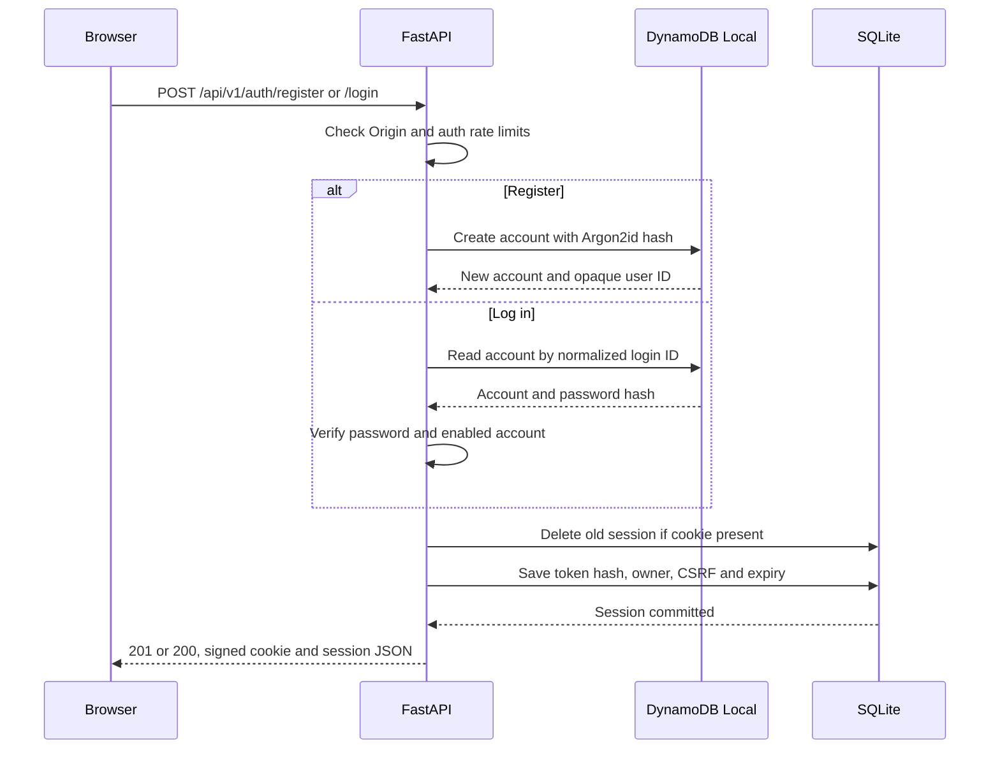
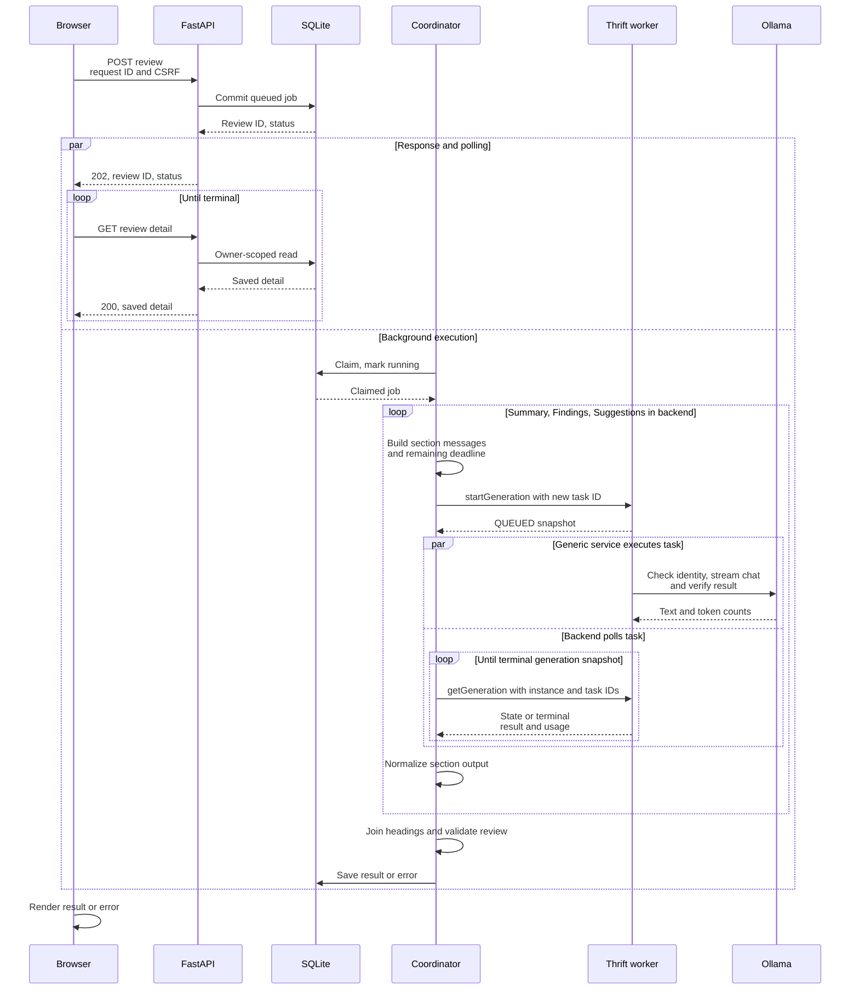
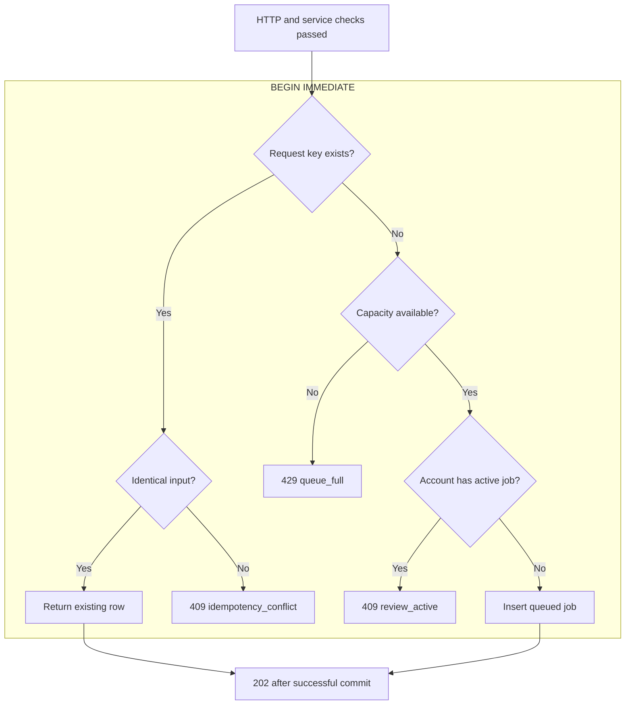
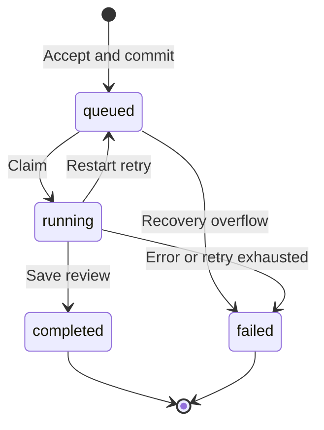
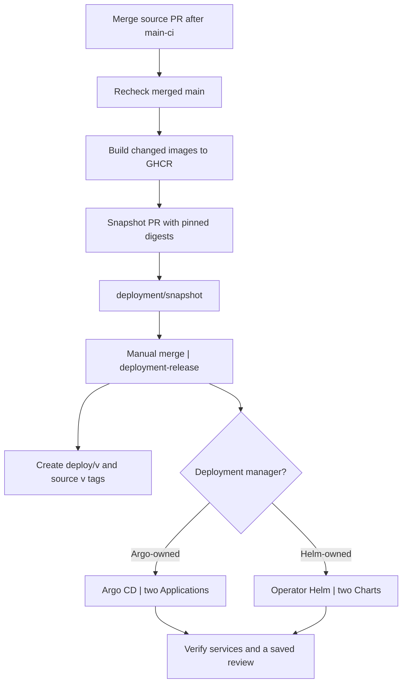
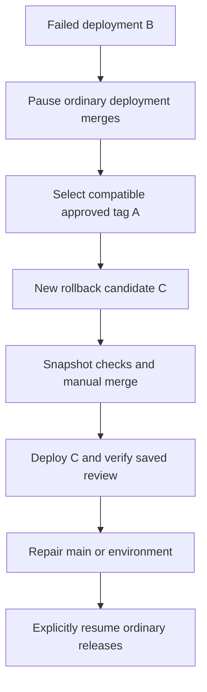

# Application and release workflows

[Documentation index](../README.md) · [Architecture](architecture.md)

LocalQwenDemo separates accepting a review, executing it, and displaying its saved
result. These diagrams follow the implemented HTTP routes, SQLite transactions,
coordinator and release workflows. Deployment numbers below use the maintained
Minikube values; Python development defaults can differ.

For a project presentation, start with the [system layout](architecture.md#system-layout),
then show the [review sequence](#review-from-submission-to-history) and
[release workflow](#release-deployment-and-rollback). The other views explain the
security, admission and recovery rules behind those three views.

| Workflow | Main question |
| --- | --- |
| [Authentication](#authentication-and-session-ownership) | How does a request acquire its account identity? |
| [Review sequence](#review-from-submission-to-history) | What happens after a user submits code? |
| [Admission](#admission-and-idempotency) | How are duplicates and queue limits handled? |
| [Generation](#model-validation-and-generation) | How does Ollama produce a validated review? |
| [Job lifecycle](#durable-job-lifecycle) | What survives a restart, and what is retried? |
| [Service lifecycle](#service-startup-timeout-and-recovery) | When is the backend ready, draining or unhealthy? |
| [Release and rollback](#release-deployment-and-rollback) | How does source become an approved deployment? |
| [Model evaluation](../testing/model-evaluation.md#evaluation-flow) | How are synthetic reviews measured and assessed? |

## Authentication and session ownership

The browser talks to FastAPI through the same-origin Nginx proxy, omitted from
sequence diagrams for space. Solid arrows are requests; dashed arrows are replies.
The diagram shows successful registration and login. Invalid credentials, Origin
checks, rate limits or storage failures stop the request before a successful response.

The cookie contains an opaque random token plus an HMAC signature. It is HttpOnly
and SameSite Strict; the maintained localhost HTTP profile sets `Secure=false`.
Only a SHA-256 hash of the cookie is stored. The browser keeps the returned CSRF
token in React state and sends it as `X-CSRF-Token` on protected mutations.

Each protected request verifies the signature, unexpired SQLite session and current
enabled DynamoDB account. Mutations also require the exact allowed Origin and CSRF
token. The session supplies `user_id` for history and detail queries; a different
owner's review returns 404. Logout deletes the server-side session and clears the
cookie. Registration and session creation do not share a transaction: an account
can remain if session persistence fails, allowing a later login.

Sources: [auth routes](../../backend/app/api/routes/auth.py),
[session rules](../../backend/app/api/auth.py), [account adapter](../../backend/app/persistence/users.py).
See [security](security.md) for the full policy.

## Review from submission to history

A 202 response confirms durable acceptance, not a completed review. Once the insert
commits, the coordinator can claim it independently of the HTTP response. Browser
polling and background execution overlap; the diagram shows them as parallel paths.
The Coordinator lane combines the backend coordinator and its client executor.
The Inference lane is a separate Thrift worker. This diagram shows normal completion;
timeout and uncertain execution are covered [below](#service-startup-timeout-and-recovery).
Submission uses
`POST /api/v1/reviews`; polling uses `GET /api/v1/reviews/{review_id}`.

Polling normally repeats after 1.5 seconds while active, or after 3 seconds following
a retryable polling failure. A page reload reads history and resumes polling an
active job. History lists omit source/result bodies; opening a detail loads them.
The browser receives complete saved results. Token streaming stays between the
Thrift worker and Ollama; backend polling uses snapshots with no partial text.
Submitted code is never executed.

If submission delivery is unconfirmed, the UI retains the exact payload and request
ID in memory and lets the user retry explicitly. It does not automatically resubmit.
The admission rules below determine whether that retry returns an existing job.

Sources: [review routes](../../backend/app/api/routes/reviews.py),
[browser workflow](../../frontend/src/Workspace.tsx), [coordinator](../../backend/app/coordinator.py),
[Thrift client](../../backend/app/inference/rpc/client.py),
[Markdown rendering](../../frontend/src/Markdown.tsx).

## Admission and idempotency

Before the transaction, the HTTP boundary checks the body, schema and authenticated
session. `ReviewService` then checks nonblank/character-bounded input, coordinator
readiness and the per-account submission quota, in that order. These checks also
apply to duplicate requests. The diagram starts after they pass.

Default capacity is eight queued jobs plus one running, with one active job per
account. Both the total-active and queued limits are checked. The unique key is
`(user_id, client_request_id)`; identical retries can return queued, running or
terminal jobs before capacity checks. Changed input under the same key returns 409.
If the client omits the key, the server generates one, so a client must retain a key
to obtain duplicate protection across retries. Storage failure rolls back the
transaction and cannot produce successful acceptance.

Sources: [ReviewService](../../backend/app/review_service.py),
[Store.create_review](../../backend/app/persistence/storage.py). See [API errors](api.md).

## Model validation and generation

The inference service starts its Ollama child, validates native version, pinned
revision, capabilities and context, then performs a generic warmup and GPU check.
Only then does it open Thrift. The backend handshakes for identity and public limits;
it does not mirror execution configuration.

The backend allocates one 384-token review budget across Summary (72), Findings
(176) and Suggestions (136). For each section it builds its own role/content
messages from the original source and language, then calls `startGeneration` and
polls by request ID. Each generation receives the remaining review deadline. The
service validates generic native results and token limits; the backend normalizes
sections, trims permitted unfinished tails and validates the complete review.
Generated sections never feed later prompts. A human still evaluates correctness.

On a lost response, the client uses `getGeneration` rather than repeating a start.
On timeout it requests `cancelGeneration` and waits for confirmed native exit.
The service owns process-group termination and pinned-model recovery. See the
[Thrift guide](../guides/apache-thrift.md) for registry expiry, duplicate behavior,
Python/Java interoperability, startup/shutdown and failure semantics.

Sources: [service adapter](../../inference-service/src/llm_service/ollama.py),
[backend orchestration](../../backend/app/inference/rpc/client.py),
[prompts](../../backend/app/inference/prompts.py),
[output checks](../../backend/app/inference/review_output.py).

## Durable job lifecycle

These four states are stored in SQLite. `submitting` is a browser-only state.
Transitions back to `queued` occur during process startup recovery, with the default
`MAX_RETRIES=1`; they are not retries of ordinary inference failures.

Restart preserves queued jobs. A stale running job with `retry_count < 1` is
requeued and its count incremented; a later interruption fails it as `interrupted`.
Recovery keeps the oldest queued jobs up to the configured capacity, including
requeued interrupted work; excess jobs fail as `queue_recovery_limit`. Completed
and failed jobs remain queryable. A timeout fails the job before executor draining
finishes, and a late result cannot replace that failure. The user can submit a new
job when the service is ready. Retrying the same request key returns the old job.
Recovery is restart-safe for the supported single process, without an exactly-once
inference guarantee or distributed worker leases.

Sources: [Store.recover, claim and finish](../../backend/app/persistence/storage.py),
[Coordinator.process](../../backend/app/coordinator.py).

## Service startup timeout and recovery

Coordinator state describes the backend process, independently of a saved job or
RPC snapshot. `ready` remains the operational state during normal execution, so
other accounts can queue work. The backend never starts another review while its
client call is draining. The service serializes native generation and bounds its
pending queue; independent clients can still submit generic tasks and query snapshots.

```mermaid
stateDiagram-v2
    accTitle: Backend coordinator startup and timeout recovery
    accDescr: The coordinator initializes stores, recovers the queue and checks the Thrift service's model identity and readiness before becoming ready. A coordinator deadline enters draining. Confirmed completion within the drain allowance restores readiness. Uncertain execution can move ready or draining directly to stuck; an expired drain also becomes stuck. Startup and storage errors require recovery.
    state "model_loading" as loading
    state "ready" as readyState
    state "inference_draining" as draining
    state "inference_stuck" as stuck
    state "startup_or_storage_failure" as failure
    [*] --> loading
    loading --> readyState: Startup checks pass
    loading --> failure: Startup error
    readyState --> draining: Timeout
    readyState --> stuck: Remote execution uncertain
    readyState --> failure: Storage or loop error
    draining --> readyState: Completion confirmed
    draining --> stuck: Drain expires or execution uncertain
    draining --> failure: Write error
```

Backend startup order is SQLite initialization → account-store check → queue recovery
→ worker handshake → final writable SQLite check. Worker startup separately performs
Ollama validation/probe before opening the RPC listener. The account-store stage
retries only allowlisted transport failures, serially, within a 120-second retry
budget; an in-flight SDK call is allowed to finish. In Kubernetes, an init container
first ensures the users table exists. See [startup recovery](../operations/recovery-and-cleanup.md).

| Operational state | Ready when not closing | Live | Consequence |
| --- | --- | --- | --- |
| `model_loading` | No | Yes | Wait for initialization |
| `ready` | Yes, if writable SQLite check passes | Yes | Admit and claim jobs |
| `inference_draining` | No | Yes | Send worker cancellation and wait for confirmed completion |
| `inference_stuck` | No | No | Stop coordinator; Kubernetes liveness restart |
| `startup_or_storage_failure` | No | No | Restart/recovery required |

`/health/ready` and `/api/v1/runtime` use the same observation. A failed writable
store check reports `storage_unavailable` without changing the coordinator state;
it is not itself a liveness failure. Runtime observations return HTTP 200, with
`accepting_submissions=false` when unavailable; readiness returns 503. Browser UI
submission gating uses runtime, while actual admission still checks readiness and
transactional limits.

Shutdown sets a separate `closing` flag, closes admission, signals cancellation and
waits for a bounded grace period. Runtime reports `shutting_down`; the last
operational state is retained. A late thread exit cannot recover from `stuck` or
reopen admission while closing. The backend Pod termination grace period is 60 seconds;
the combined inference Pod gets 45 seconds. Python cannot forcibly kill the client
executor thread; the service owns termination of the native process group.
An adapter-reported timeout that
has already returned can fail a job without entering the coordinator drain path.

Sources: [coordinator](../../backend/app/coordinator.py),
[readiness](../../backend/app/health.py), [account startup check](../../backend/app/persistence/users_startup.py),
[backend Deployment](../../deploy/helm/local-review/templates/deployment-review-backend.yaml).

## Release deployment and rollback

`main` owns source and trusted release tools. `deployment-release` owns approved
snapshots. CI validates configuration without cluster access; approval, deployment
and real business acceptance are separate stages.

Failed quality or snapshot checks stop promotion. Snapshot validation covers
provenance, Chart rendering, Kubernetes schemas, monitoring rules and dashboards;
it does not execute a model review. Backend/frontend images target AMD64 and ARM64;
the GPU Ollama image targets ARM64. Deployable inputs that have not changed reuse
their approved image digests. A docs-only change can produce no release candidate.

The snapshot pins images and includes both Charts. Choose one manager per deployment.
Argo CD renders Helm templates and reconciles resources; these are not ordinary
Helm-installed releases. The two Applications reconcile independently. Tags record
approved desired state, not successful deployment, and a tagging failure does not
block Argo CD from syncing an already merged snapshot.

For a fresh environment, prepare the cluster, StorageClass, namespaces, GPU platform
and external Secrets, then deploy the inference release before the application.
It reuses the model PVC, optionally downloads a missing pinned model, and checks
capabilities/context and GPU warmup before opening RPC. A separate Helm test or
Argo PostSync hook performs real generation over Thrift. The backend checks actual
identity and readiness, while its application prompts remain independent. Complete
a real UI review and check saved history after deployment. For an existing instance,
use the [coordinated migration and rollback](../operations/inference-migration.md).

An audited rollback uses the same snapshot validation and manual approval, while
recovering the deployment before normal releases resume:

The rollback copies the approved snapshot into a **new** candidate based on
the current release head, reuses its exact images without rebuilding, and passes
the same validation and manual merge. Keep Argo auto-sync and main CI running while
ordinary deployment merges are paused. Rollback restores configuration, not PVC
data, Secrets or external platform state. Recheck data compatibility, verify the
recovery, and repair source/environment before explicitly resuming normal releases.

Sources: [quality checks](../../.github/workflows/ci.yml),
[candidate workflow](../../.github/workflows/release-candidate.yml),
[snapshot validation](../../.github/workflows/deployment-validation.yml),
[tag finalization](../../.github/workflows/release-finalize.yml),
[Argo Applications](../../deploy/argocd), [Ollama runtime](../../inference-service/src/llm_service/runtime.py).
Use the [GitOps](../guides/gitops.md), [Helm](../guides/helm-release.md),
[platform](../../infra/local-platform/README.md) and [rollback](../guides/release-rollback.md)
guides for executable steps.

## Maintaining the diagrams

The Mermaid fences in this page and the linked references are the editable sources.
GitHub renders them in place. Keep labels short and put policy details beside each
diagram. Update the relevant diagram and its source links when changing routes,
storage, model execution, health transitions or release ownership. The architecture
page's [implementation map](architecture.md#implementation-map) identifies the
code to inspect. Dated reports describe their recorded revisions rather than the
current design.
