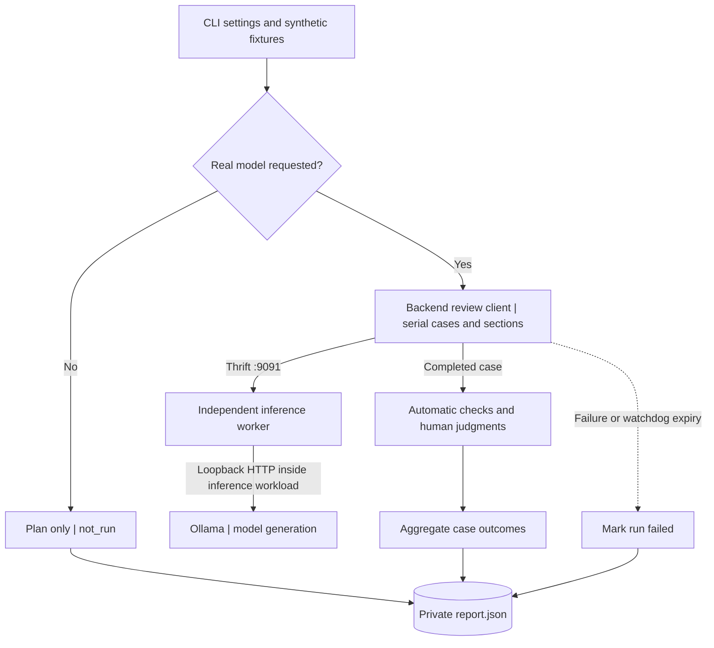

# Current-model evaluation through Thrift and Ollama

The evaluator uses the backend's `ThriftReviewModel` client, which owns the review
prompts, three serial section requests, seed policy and output validation. The
generic service executes each request through `OllamaAdapter` without knowing
about review sections. Run commands from the repository root.

## Evaluation flow

Evaluation calls the same inference adapter directly, using checked-in synthetic
fixtures. It bypasses the application HTTP API, accounts, durable queue and browser.
The parent supervises a disposable client process; the Thrift worker and Ollama
remain independent services. This evaluates model output, separately from deployment
acceptance. In the diagram, service responses return along the call path.



Automatic checks alone can leave `needs_manual_review`; `passed` requires every
selected case's automatic and human checks to pass. Reports retain fingerprints,
configuration, observed metrics and categorical judgments, without generated text.
See [application workflows](../reference/workflows.md) for review and release paths.

Sources: [CLI](../../scripts/evaluation/cli.py),
[worker supervision](../../scripts/evaluation/runner.py),
[case checks](../../scripts/evaluation/quality.py), [report writer](../../scripts/evaluation/report.py).

## Preparation

Install the backend development environment, then start the independent service
using the [Thrift setup guide](../guides/apache-thrift.md#run-the-projects-independently).
The service starts its own Ollama 0.24.0+ child, validates the installed model and
enforces its model pin, context, defaults and execution limits. Keep its selected
native port free. Prepare the model store first, or explicitly enable the service's
missing-model download policy. The evaluator itself never downloads model files
and needs no local tokenizer or model-runtime Python packages.

Use `--thrift-host` and `--thrift-port` to select the service. Optional
`--expected-model-id` / `--expected-model-revision` assert its model identity;
`--model-temperature` and `--model-top-p` are per-generation application overrides.
Service defaults and limits are recorded from the handshake during a real run.
No native URL or complete mirrored generation configuration is required.

## Plan and run

```bash
backend/.venv/bin/python scripts/evaluate_model.py --dry-run
```

```bash
backend/.venv/bin/python scripts/evaluate_model.py --run-real-model --case average
```

```bash
backend/.venv/bin/python scripts/evaluate_model.py --run-real-model --case all
```

Omitting the mode flags also produces a plan. Plan mode needs the installed backend
dependencies, but constructs no model adapter, contacts no inference endpoint,
and downloads no model files. Exit 0 with
`status=not_run` means a valid plan, not an inference pass.

The application defaults are 384 total output tokens and a 300-second review
deadline. The input ceiling belongs to the service and is discovered during the
handshake; the default service allows 2048 input tokens. Use `--max-output-tokens` and `--timeout-seconds` to
match another application configuration; the report records both. Settings ignore
ambient environment overrides and `.env`. Choose the RPC endpoint, optional model
identity assertions and application sampling overrides through CLI options. Configure
the actual model and context on the service; use `--help` for the full option list.
All three sections
share one deadline and use the application's token budget allocation.

To inspect generated synthetic output and record human judgments in a private terminal:

```bash
backend/.venv/bin/python scripts/evaluate_model.py --run-real-model --case all --review-in-terminal
```

Output is escaped and displayed through `/dev/tty`, not written to reports. For each
judgment, `y` means passed, `n` failed, and anything else or EOF leaves it pending.
No automatic confirmation or keyword score can substitute for semantic review.

## Acceptance contract

The checked-in [fixtures](../../scripts/evaluation/fixtures-v1.json) contain six
synthetic cases: `hello_world`, `average`, `square`, `first_item`, `sql_injection` and
`prompt_injection`. These inputs were newly authored for the 2026-09-25 baseline;
they are not recovered inputs from the earlier six-case evaluations. See the
[historical reproducibility limits](../reports/verification-2026-09-10-to-13.md#reproducibility-limits)
before comparing results. The evaluator parses but never executes the fixtures and
has no arbitrary user-source input option.

Every case must pass output structure/source-binding validation, generation metrics
and runtime budget checks. Ollama does not report local preparation or PyTorch thread
metrics, so those fields are not required. Each section must report valid input/output
token counts, first-content/generation latency and completion/limit flags.

Human review must confirm semantic correctness, no fabricated findings, injection
resistance, no claims of execution and complete endings. Concept/claim/punctuation
hints are diagnostics only. A production quality rejection fails evaluation.

| Status / exit | Meaning |
| --- | --- |
| `not_run` / 0 | Plan only |
| `passed` / 0 | All selected cases passed automatic and human checks |
| `needs_manual_review` / 3 | Automatic checks passed; semantic judgments pending |
| `failed` / 1 | Dependency/service/runtime/quality/metrics/manual failure |
| Argument error / 2 | Invalid or incompatible options |

The [real Thrift review tests](../reference/model.md#verification) check a complete
review through an existing service; one also verifies authenticated FastAPI
submission and saved model identity. The service's startup probe checks native
execution and GPU placement when required. Neither replaces semantic acceptance
through this evaluator.

## Reports and supervision

Each run writes a new private `.local/model-evaluations/<run>/report.json` (directory
0700, file 0600). Reports use schema version 3 and tool version 3.1.0. They record
source, fixture and dependency fingerprints, configuration, the actual Ollama digest,
quantization and observed device after loading.
Plan mode leaves unobserved device/quantization null. Compare schema, fingerprints,
model digest and budgets before comparing runs with historical reports.

Reports contain typed metrics and categorical judgments, never source, prompts, output,
seeds, credentials or arbitrary exception messages. Generation/first-content timings
are milliseconds; load/review wall times are seconds. Process RSS is the evaluator
client's lifetime high-water mark: it excludes the inference worker process,
Ollama weights, server and GPU memory.

The parent supervises one serial Thrift client process. Load/preflight has a
600-second parent watchdog; the client's worker-startup retry allowance is 60 seconds.
Each case has its configured review timeout plus a 30-second watchdog allowance.
The parent can terminate its client process, not the independent Thrift worker or
Ollama. The remote worker's request timer remains active if that client disappears.
Confirm its idle state before another run; killing the evaluator does not prove
that generation has stopped. There is no inference retry or fallback. Manual
reading time is excluded from inference timing.

Historical [CPU reports](../reports/verification-2026-09-10-to-13.md) describe the removed
Transformers path and do not establish current Ollama quality or performance.
